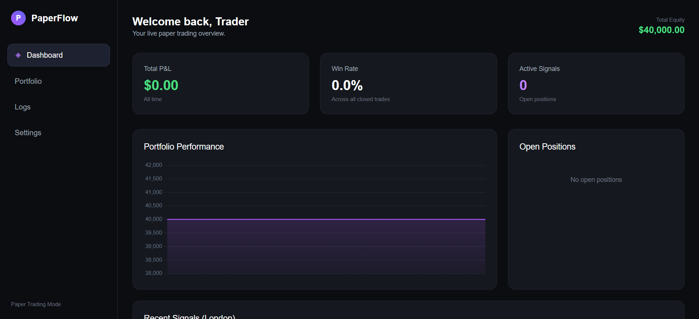

# Win Rate vs Breakeven & Exit Distribution

**An open-source crypto trading research engine in Python: order-flow confirmation gate, honest backtesting (win rate vs breakeven win rate, exit distribution, bootstrap confidence intervals), a live paper trader, and a real-time dashboard for Binance USDⓈ-M futures.**


> **Paper trading only.** This project never places real orders on any exchange. It is research software, not financial advice. See the [disclaimer](#disclaimer).



---

## What is this?

Most trading backtests report a win rate and stop there. A win rate means nothing until you compare it with the **breakeven win rate** that your reward-to-risk ratio and trading fees require. This repo is built around that question:

> *Does the strategy win more often than it needs to, after fees and slippage, and is that edge statistically distinguishable from luck?*

It gives you one code path for both research and live paper trading, so a backtest trade is a live trade replayed on history.

## Key features

- **Win rate vs breakeven win rate**: every backtest reports the breakeven win rate implied by the actual exits and fees, next to the observed win rate.
- **Exit distribution**: how trades ended (stop, time stop, target, restart) and the average R per exit type.
- **Gross vs net R with bootstrap 95% confidence intervals**: separates "no entry edge" from "edge eaten by fees".
- **Random-entry baseline**: compares the strategy against random signals so you can see if the result beats chance.
- **Train/test split and parameter grid**: out-of-sample checking by time, with CLI overrides for stop, target, hold, cooldown and slippage.
- **Three-bucket confirmation gate**: structure (volume profile), aggression (order flow delta), and an optional options-gamma (GEX) veto.
- **Four strategies**: `trend` (default), `sweep`, `absorption`, `funding_fade`.
- **Realistic paper execution**: signals fill at the next bar open, taker/maker fee model, slippage, one position at a time, state saved to disk so restarts resume cleanly.
- **Live dashboard**: FastAPI + Chart.js equity curve, open positions and latest signals.
- **Optional LLM narrative**: Groq-powered rationale for each decision (off unless you set an API key).
- **Docker and Render ready.**

## How it works

```
Binance WebSocket / REST  ->  bars + volume profile  ->  Bucket A (structure)
                                                         Bucket B (order-flow aggression)
                                                         Bucket C (GEX veto, optional)
                                                                  |
                                                         Confirmation gate (engine/decision.py)
                                                                  |
                                              PaperTrader (next-open fill, fees, slippage, exits)
                                                                  |
                                                 logs/  ->  FastAPI dashboard
```

The same `Decider` (gate) and `PaperTrader` are used by the live runner and by the backtest, so the two cannot drift apart.

### The default strategy: trend (4h, London session)

| Setting | Value |
|---|---|
| Timeframe | 4h bars |
| Entry signal | Close breaks the 40-bar high (long) or 40-bar low (short), Donchian-style |
| Session filter | Entries only during London hours (08:00-16:00 UTC) |
| Stop | 2x ATR, trailed after each completed bar |
| Target | None (trailing stop), plus a time stop after 90 bars |
| Symbols | BTCUSDT, ETHUSDT, XRPUSDT, ADAUSDT |
| Fees / slippage | Venue fee table (taker/maker), plus configurable slippage |

All of these are environment variables (see [Configuration](#configuration)).

## Quick start

```bash
git clone https://github.com/techakash32/win-rate-vs-breakeven-and-exit-distribution.git
cd win-rate-vs-breakeven-and-exit-distribution

python -m venv .venv
source .venv/bin/activate        # Windows: .venv\Scripts\activate
pip install -r requirements.txt
```

### Run the live paper trader

```bash
export ACTIVE_STRATEGY=trend
export BACKTEST_INTERVAL=4h
export BUCKET_B_ENABLED=false
export TREND_LONDON_ONLY=true
export PAPER_SLIPPAGE_PCT=0.04
export SYMBOLS=BTCUSDT,ETHUSDT,XRPUSDT,ADAUSDT

python -m scripts.paper_live
```

On Windows PowerShell use `$env:NAME = "value"` instead of `export`.

`paper_live` refuses to start if the configuration does not match the validated profile above, so you never silently paper-trade the wrong settings.

### Run the dashboard

```bash
python -m uvicorn scripts.dashboard:app --host 0.0.0.0 --port 8000
```

Open http://localhost:8000. The JSON feed is at `/api/dashboard`.

### Run a backtest

```bash
# Quick look using approximate volume profile
python -u -m scripts.backtest_step5a --vp approx --days 30

# Real per-price volume from Binance Vision aggTrades, fixed end date
python -u -m scripts.backtest_step5a --vp real --days 14 --end-date 2026-10-26

# Parameter sweep with a train/test split
python -u -m scripts.backtest_step5a --vp real --days 14 --grid

# Try different exits without editing settings.py
python -u -m scripts.backtest_step5a --vp real --days 14 \
  --stop 0.6 --target-r 1.5 --hold 90 --cooldown 15 --tag wide
```

Each run writes `summary_<tag>.json` and `trades_<tag>.jsonl` to `logs/backtest/` so runs never overwrite each other. The summary includes win rate, breakeven win rate, exit distribution, average R by exit, gross and net R with bootstrap intervals, and a random-entry baseline.

> `--vp approx` spreads each bar's volume evenly across its range, which behaves differently from live. Confirm anything promising with `--vp real` before trusting it.

## Deploy

### Docker

```bash
docker build -t winrate .
docker run -p 8000:8000 -v winrate_logs:/app/logs winrate
```

The container starts the paper trader and the dashboard together via `start.sh`. Mount `/app/logs` as a volume to keep paper-trading state across restarts.

### Render

1. Create a **Web Service** from this repo.
2. Build command: `pip install -r requirements.txt`
3. Start command: `bash start.sh`
4. **Choose a non-US region** (Frankfurt or Singapore). Binance returns HTTP 451 to US servers.
5. Add a persistent disk for `logs/` if you want state to survive restarts.

## Configuration

Set these as environment variables.

| Variable | Default | Purpose |
|---|---|---|
| `ACTIVE_STRATEGY` | `trend` | `trend`, `sweep`, `absorption` or `funding_fade` |
| `BACKTEST_INTERVAL` | `4h` | `5m`, `15m`, `1h`, `2h`, `4h`, `1d` |
| `SYMBOLS` | `BTCUSDT,ETHUSDT,XRPUSDT,ADAUSDT` | Comma-separated Binance USDⓈ-M symbols |
| `VENUE` | `binance` | Fee table: `binance`, `bybit`, `okx`, `binance_vip`, `bybit_vip`, `zero_fee` |
| `PAPER_SLIPPAGE_PCT` | `0.04` | Slippage in percent |
| `TREND_DONCHIAN_LOOKBACK` | `40` | Breakout window in bars |
| `TREND_ATR_WINDOW` / `TREND_ATR_MULTIPLE` | `14` / `2.0` | ATR stop sizing |
| `TREND_LONDON_ONLY` | `true` | Restrict entries to London hours |
| `BUCKET_B_ENABLED` | `false` | Enable the order-flow aggression bucket |
| `GROQ_API_KEY` | unset | Enables the LLM narrative layer |
| `FLASHALPHA_API_KEY` | unset | Enables GEX data for the optional Bucket C veto |

## Project structure

```
config/       settings and gate parameters
data/         Binance WebSocket, historical bars, bar aggregation, GEX and funding data
features/     volume profile
gate/         buckets and the confirmation gate
engine/       Decider (shared decision logic) and live pipeline
execution/    PaperTrader (fills, fees, exits, persistence)
scripts/      paper_live, dashboard, backtest, data checks, verification steps
llm/          optional Groq narrative layer
dashboard/    single-page dashboard UI
```

## Requirements

- Python 3.13 (3.14 also installs cleanly)
- Dependencies: `websockets`, `fastapi`, `uvicorn`, optional `groq` and `flashalpha`, `python-dotenv`
- Network access to Binance USDⓈ-M futures (not available from some regions, including the US)

## FAQ

**What is breakeven win rate?**
The win rate a strategy needs just to cover its losses and fees, given its average win and loss size. If your observed win rate is below it, the strategy loses money even though it wins often.

**Does this trade real money?**
No. It is paper-only and never sends orders to an exchange.

**Why compare against a random baseline?**
A good-looking result on a small sample can happen by chance. The random-entry baseline and the bootstrap confidence intervals show whether the edge is distinguishable from noise.

**Why does it show HTTP 451 from Binance?**
Binance blocks requests from certain regions, including US servers. Run it from another region.

**Can I add my own strategy?**
Yes. Add a bucket-A evaluator in `engine/decision.py` and register the strategy name in `gate/confirmation_gate.py`.

## Status

Live exchange execution (`execution/live_trader.py`) is an empty placeholder by design. Everything runs in paper mode.

## Contributing

Issues and pull requests are welcome. Please open an issue first for larger changes.

## Disclaimer

This software is provided for educational and research purposes only. It is **not** financial, investment or trading advice. Trading leveraged crypto derivatives carries a high risk of loss. Backtested and paper-traded results do not guarantee future performance. Use at your own risk; the authors accept no liability for any loss.

## License

No license has been added yet. Until one is added, all rights are reserved by the author. If you want others to use and contribute to the project, add an open-source license such as MIT.

---

**Keywords:** algorithmic trading, quantitative trading, crypto trading bot, backtesting engine, paper trading, order flow, volume profile, Donchian breakout, trend following, ATR trailing stop, breakeven win rate, expectancy, risk-reward ratio, bootstrap confidence interval, Binance futures, FastAPI dashboard, Python, Docker.
